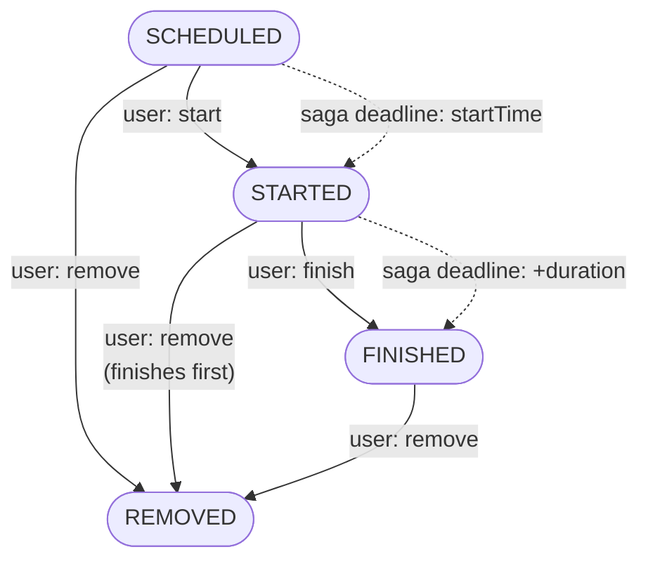
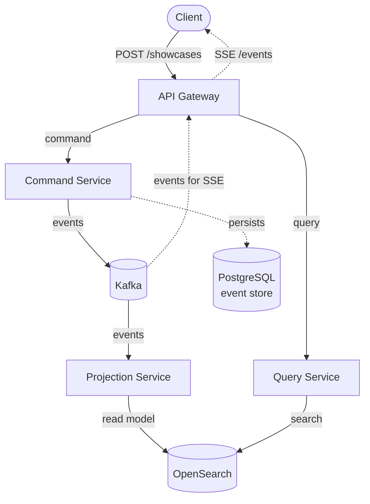
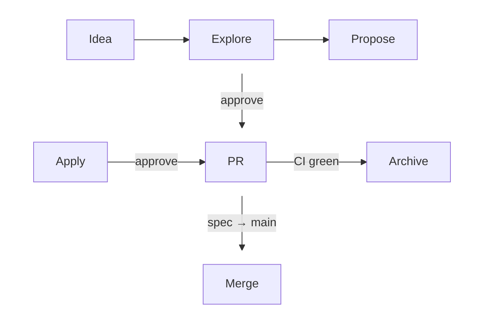

# axon-showcase

[](https://github.com/aanbrn/axon-showcase/actions/workflows/ci.yml)
[](LICENSE)


A CQRS / event-sourced reference application you can _watch work_ — and a demonstration of an agent-assisted,
spec-driven way to build it.

It is not a toy CRUD app. It is a complete event-sourced system: schedule a showcase and it drives itself through its
lifecycle — starting at the right time, finishing after its duration, streaming every event live to a browser UI that
updates as it happens. And the way the code is written and reviewed is itself a demonstration: behavior is captured in
specs, changes are proposed, applied, reviewed, and archived by an automated agent pipeline. That pipeline also **learns
from itself**: every unit records the process defects it observes, and you turn those records into rules when they are
due, which the pipeline reads on the next change (see [The Self-Learning Loop](#the-self-learning-loop)). It can even
bootstrap its own tooling — ask it to set up the MCP servers and it detects, wires, and installs what it can for you
(see [Tooling MCP Servers](#tooling-mcp-servers)).

It is also a personal vehicle for learning agentic development: the process is as much the point as the product.

## Project Structure

```
axon-showcase/
├── Services and gateway
│   ├── showcase-api-gateway/            # REST (/showcases), SSE (/events), client telemetry (/telemetry)
│   ├── showcase-command-service/        # Write side: Axon aggregate, saga, distributed bus
│   ├── showcase-projection-service/     # Consumes Kafka, writes read models to OpenSearch
│   ├── showcase-query-service/          # Read side: queries OpenSearch, gRPC query transport
│   └── showcase-web-ui/                 # Standalone browser UI (React + Vite, Feature-Sliced Design)
├── API and clients
│   ├── showcase-command-api/            # Command-side API interfaces
│   ├── showcase-command-client/         # Reactive command client
│   ├── showcase-query-api/              # Query-side API interfaces
│   ├── showcase-query-client/           # Reactive query client
│   └── showcase-query-proto/            # Protobuf + gRPC definitions for queries
├── Shared libraries
│   ├── showcase-projection-model/       # Shared query model definitions
│   ├── showcase-identifier-extension/   # KSUID identifier support
│   ├── showcase-mapstruct-extension/    # MapStruct extensions
│   ├── showcase-resilience4j-extension/ # Resilience4j integration
│   └── showcase-test/                   # Shared test utilities
├── Build and deployment
│   ├── build-logic/                     # Gradle convention plugins
│   ├── gradle/                          # Version catalog (libs.versions.toml)
│   ├── platform/                        # Shared BOM and dependency management
│   ├── helm/                            # Helm charts for Kubernetes deployment
│   │   └── chart/                       # Main chart for the application
│   ├── docker-compose.yml               # Local development with Docker Compose
│   └── load-tests/                      # Gatling-based load tests
├── Documentation and process
│   ├── docs/adr/                        # Architecture decision records
│   └── openspec/                        # Spec-driven behavior specs and changes
├── Scripts
│   ├── db.sh                            # Database setup (init / drop / reset)
│   ├── setup-hosts.sh                   # Manage /etc/hosts entries for the local ingress
│   └── scripts/                         # Dev tooling: checkers, dev scripts, and guards
```

## The Cool Story

The domain is deliberately simple — a "showcase" is a scheduled, timed event with a lifecycle. The value is in _what the
plumbing does with it_:



<details>
<summary>Plain-text version (for renderers without Mermaid)</summary>

```
      ┌───────────────┐
      │   SCHEDULED   │───────────────┐
      └───────┬───────┘               │
              │ user: start           │
              │ ┄ saga: startTime     │
      ┌───────────────┐               │
      │    STARTED    │───────────────┤
      └───────┬───────┘               │
              │ user: finish          │
              │ ┄ saga: +duration     │
      ┌───────────────┐               │
      │    FINISHED   │───────────────┤
      └───────────────┘               │
                                      │  user: remove
                                      │  (a started showcase is
                                      │  finished before removal)
              ┌───────────────────────┘
              ▼
      ┌───────────────┐
      │    REMOVED    │
      └───────────────┘
```

</details>

You can also drive the lifecycle by hand — start or finish a showcase before the saga does, or remove it at any time.

- **The saga runs the show.** When you schedule a showcase, an Axon **saga** (in `ShowcaseSaga`) sets a deadline to
  start it at the scheduled time, then another to finish it after the configured duration. You can schedule a showcase
  and literally watch it auto-start and auto-finish without touching anything.
- **Everything is an event.** Every transition is an Axon domain event, stored in the PostgreSQL event store, published
  to Kafka, projected into OpenSearch, and streamed live to browsers over **SSE** (`/events`).
- **The command side scales.** The command service runs a **distributed command bus** (JGroups). In the local deployment
  its two replicas and the API gateway form one JGroups cluster — peers discover each other through the Kubernetes API
  (KUBE_PING) and commands route across all nodes — so the write side scales out like a real system. Every service can
  be autoscaled (HPA/VPA) and protected with Pod Disruption Budgets.
- **The read side speaks gRPC.** The gateway reads through the query service over a **generic** gRPC RPC — one method
  carries any query, and the query service dispatches it on its own `QueryBus`. It fills the distributed-query-bus role
  **without Axon Server** (see `docs/adr/0017`), just as the command side uses a JGroups command bus.
- **A real browser UI shows it live.** The React UI renders the event timeline, listens to the SSE stream, and
  reconciles against the eventually-consistent read model — so you see the saga's transitions appear live.
- **Resilience is built in.** The command and query clients apply **Resilience4j** circuit breakers, time limiters, and
  retries, and the gateway serves repeated reads from a read-through cache.
- **It is observable.** Tempo traces, Prometheus metrics (including web-UI nginx metrics), a dedicated Grafana
  dashboard, health checks, and Gatling load tests are wired in — the same observability a production service needs. The
  projection service exposes its observed lifecycle state and last resolved batch time (`showcaseProjector.state` and
  the readiness detail); readiness reports `DOWN` before initial assignment and during stream-restart waits, and can
  remain `UP` while Kafka is unreachable after assignment. Observability is available in the **Kubernetes deployment**
  (Prometheus, Grafana, and Tempo run in the `monitoring` namespace); the local docker-compose stack runs without it.
- **Identifiers are KSUIDs** (sortable, collision-resistant), enforced through a custom identifier extension.

## Architecture

The application follows **CQRS (Command Query Responsibility Segregation)** with four services and the web UI:

| Component              | Role                                                                                          |
| ---------------------- | --------------------------------------------------------------------------------------------- |
| **API Gateway**        | REST entry point (`/showcases`), SSE live events (`/events`), client telemetry (`/telemetry`) |
| **Command Service**    | Write side: Axon aggregate, saga, distributed command bus (JGroups), PostgreSQL event store   |
| **Projection Service** | Consumes events from Kafka, writes read models to OpenSearch                                  |
| **Query Service**      | Read side: queries OpenSearch, gRPC query transport                                           |

### Event Flow



<details>
<summary>Plain-text version (for renderers without Mermaid)</summary>

```
                       ┌───────────────────┐
╎╌╌╌╌╌SSE /events╌╌╌╌╌►│       Client      │
╎                      └───────────────────┘
╎                                │ POST /showcases
╎                                ▼
╎                      ┌───────────────────┐
╎╌╌╌events for SSE╌╌╌╌►│    API Gateway    │
╎                      └───────────────────┘
╎                                │
╎              ┌─────────────────┴─────────────────┐
╎  command     │                                   │ query
╎              ▼                                   ▼
╎    ┌───────────────────┐               ┌───────────────────┐
╎    │  Command Service  │               │   Query Service   │
╎    └───────────────────┘               └───────────────────┘
╎              │ events                            │ search
╎              ├─────────────────────┐             │
╎              │                     │ persists    │
╎              ▼                     ▼             │
╎    ┌───────────────────┐ ┌───────────────────┐   │
╎╌╌╌╌│       Kafka       │ │     PostgreSQL    │   │
     └───────────────────┘ │    event store    │   │
               │ events    └───────────────────┘   │
               ▼                                   │
     ┌───────────────────┐                         │
     │ Projection Service│                         │
     └───────────────────┘                         │
               │ read model                        │
               └─────────────────┬─────────────────┘
                                 ▼
                       ┌───────────────────┐
                       │     OpenSearch    │
                       └───────────────────┘
```

</details>

A scheduled showcase flows through the whole pipeline: the command service stores the event and publishes it, the
projection service builds the read model, the query service serves it, and the gateway streams the event live to any
subscribed browser — all from one `POST /showcases`.

## Technologies

### In the System

- **Java 21** and **Spring Boot 3.5.16** (a Spring Boot 4 migration is deferred — see `docs/adr/0004`)
- **Axon Framework** — aggregates, sagas and deadlines, command/query buses, and a **JGroups** distributed command bus;
  deliberately run **without Axon Server** (a project intention — see `docs/adr/0009`), with queries crossing to the
  query service over a generic **gRPC** transport that fills the distributed query bus role (`docs/adr/0017`)
- **PostgreSQL** — the Axon event store
- **Apache Kafka** — event streaming between services
- **OpenSearch** — the read-side projection store
- **React + Vite + TypeScript** — web UI (TanStack Query, Redux Toolkit, React Hook Form + Zod, Vitest, Playwright),
  Feature-Sliced Design
- **KSUID** identifiers, **MapStruct** mapping, **Resilience4j** resilience, **Protobuf + gRPC** inter-service queries
- **Helm** + **Kubernetes** — deployment (HPA/VPA/PDB, network policies, ingress)
- **Prometheus / Grafana / Tempo** — metrics, a custom observability dashboard, and distributed tracing (in the
  Kubernetes deployment)
- **Gatling** — load tests

### In the Process

- **Gradle** (Kotlin DSL) with **build-logic convention plugins** and a version catalog
- **Spotless** — palantir-java-format for Java, ktfmt for Kotlin/Gradle DSL, Prettier for markdown
- **Checkstyle, SpotBugs, ErrorProne (NullAway + JSpecify), JaCoCo coverage gate** — all in `check`, no IDE required
  (the web UI has its own Vitest coverage gate)
- **actionlint** — lints the GitHub Actions workflows
- **Snyk and `npm audit`** — dependency security scanning (JVM classpaths and web-UI npm packages); **gitleaks** — a
  source-secret scan in the merge gate
- **OpenSpec** — spec-driven behavior capture (`propose → apply → archive`)
- **OpenCode** — the agentic coding tool driving the process: slash-commands, spec-aware subagents, a self-learning loop
  that records process defects and generalizes them, on-request setup of its own tooling
  ([Tooling MCP Servers](#tooling-mcp-servers)), and a project practice of reporting a dependency's gap back upstream —
  with a reproduction — instead of only working around it
- **GitHub Actions** — CI (with a gitleaks source-secret scan), e2e, dependency, helm, buildpack and tooling updates,
  security scans

## Development Workflow

> Just want to run the project? Skip to [Getting Started](#getting-started).

### Spec-Driven Development

This repository is built spec-first. Behavior is captured as OpenSpec specs under `openspec/specs/` (the behavioral
source of truth) and changes are planned under `openspec/changes/` using the propose → apply → archive workflow (via the
`/opsx-*` OpenCode commands / `openspec-*` skills). `AGENTS.md` records the development workflow and conventions — read
it before contributing.

Every change flows through the same loop:



<details>
<summary>Plain-text version (for renderers without Mermaid)</summary>

```
┌─────────┐            ┌─────────┐            ┌─────────┐
│   Idea  │───────────►│ Explore │───────────►│ Propose │
└─────────┘            └─────────┘            └─────────┘
                                                   │ approve
     ▼─────────────────────────────────────────────┘
┌─────────┐            ┌─────────┐            ┌─────────┐
│  Apply  │──approve──►│    PR   │─CI green──►│ Archive │
└─────────┘            └─────────┘            └─────────┘
                                                   │ spec → main
                            ▼──────────────────────┘
                       ┌─────────┐
                       │  Merge  │
                       └─────────┘
```

</details>

An idea becomes a **proposal** (what and why), then a **spec delta** (the new behavior, scoped to a capability), a
**design** (how), and **tasks**. Applying writes the code and tests. Each phase ends in **two reviews**: an
**auto-review** (the `review-quick` subagent, repeated until it finds nothing new) and your **manual review** — before
it, the agent checks the branch against `origin/main`, refreshing it when it has fallen behind so you review the diff
against current `main`, and then stages the unit's new files so the pass shows them in your IDE's Changes panel; a
conflict is resolved for both sides rather than by picking one, and the agent asks you to decide when the branch carries
both its own commits and uncommitted work — and, after implementation, a deep `review-thorough` pass whenever the review
gate's routing decision requires one. The change's single **PR** may be opened as a draft after the proposal review (to
share the plan) and is opened for real after the implementation review — it's the same PR, on which CI runs. Once CI is
green and you approve, the change is **archived** — the change dir moves to `openspec/changes/archive/` and its delta
spec is folded into the main spec — as a commit in the same PR, then merged. So the main spec always describes behavior
the code has been verified against.

A vague idea is usually sharpened first in **explore mode** (`/opsx-explore`) — a thinking stance that investigates the
codebase and clarifies what to build, without writing code. Only when the idea is concrete enough does it become a
proposal.

The loop is **iterative, not a strict pipeline** — you can step back and rework at any point. A question in review can
send you back to the proposal, a realization mid-implementation to the spec delta; the agent revises the affected
artifacts (`/opsx-update` reworks a change's planning artifacts) and re-verifies. The loop repeats until the change is
right — the archive is a snapshot of a settled state, not the end of a one-way flow.

The specs are organized by architectural role (`gateway`, `write-side`, `read-side`, `clients`, `extensions`,
`deployment`, `quality`) — a capability spec per capability, grouped into these role areas, covering everything from the
REST API and the event pipeline to the identifier extension and the dependency-management policy. Every implemented
change is archived under `openspec/changes/archive/` (120+ and counting), so the spec structure itself tells the
project's history: the main spec is always in sync with behavior the code has been verified against, and a change's
delta spec shows what a specific feature introduced.

The corpus itself is kept well-structured and mutually consistent by the `specs-auditor` subagent (`/audit-specs`, on
demand): it checks title ↔ capability-path match, Purpose ↔ requirements fit, requirement conventions, cross-spec
duplication, and dead cross-references — the structural drift `openspec validate` does not catch, not behavior against
the code. It verifies a dead reference before reporting it and classifies a duplicate before reporting it, so a
generated class or a deliberately repeated convention is not reported. It reports findings with their evidence line and
suggested rewrites, and never edits the specs itself.

Emerging ideas are parked in `docs/ideas.md` — a lightweight, date-grouped scratchpad (added to via `/ideas`, removed
once implemented or decided against) rather than a backlog of planned work. A parked idea is the usual starting point
for an explore session that decides whether it deserves a proposal.

An idea isn't the only entry point, though: a session can start just as well from a reported issue, a failing CI job, or
any other observation — you describe it in a prompt; the agent investigates (reading the issue or the failing check
through the GitHub MCP) and proposes from there. The loop is identical whatever kicked it off; `docs/ideas.md` holds
un-acted ideas — it is not a required gate.

Cross-cutting architecture decisions and their rationale are recorded as Architecture Decision Records under
`docs/adr/`. OpenSpec captures what the system does and how a change is planned; ADRs capture why the system is shaped
the way it is. An `architecture-auditor` subagent (`/audit-architecture`, on demand) checks that those decisions still
describe the system — an ADR the code has outgrown, a boundary that drifted, or a decision made in code without an ADR —
and surfaces design observations separately for your judgment, including where a deliberate choice's rationale was never
written down and a record whose recorded premise now looks met — a deferral's condition, or a parked idea whose work has
landed, fully or partly, or whose objective a different mechanism achieves. It resolves a disagreement between records
by authority (reporting an unresolvable one as an observation rather than a defect), judges a dependency edge only
against a recorded rule, and states no conclusion it cannot verify.

### The Agentic Process

This repository is developed through a **spec-first, agent-assisted workflow** powered by
[OpenCode](https://opencode.ai) — an AI coding agent you drive interactively from its **TUI** (terminal) or **Desktop**
app. You describe what you want in plain language, and the agent does the work: it proposes a plan, writes the code,
runs the gates, reviews itself, and opens the PR. You steer and approve; the agent implements.

Talk to the agents in your own language and receive replies in it, while repository artifacts stay in English (see the
output-language convention in [`AGENTS.md`](AGENTS.md#conventions)).

It also runs on GitHub: commenting `/oc …` on an issue or pull request runs the same agent in GitHub Actions, where it
opens a PR (or commits to the current one) — the remote path to the same workflow, so a phone comment can start a
change.

The repo's `.opencode/` config pins most agents to `opencode-go/*` models, available through an **OpenCode Go**
subscription — and the `vision` agent is pinned to `opencode-go/claude-haiku-5-5`, a multimodal model on that plan. The
`technical-advisor` is the exception: it is pinned to `openai/gpt-6.1-sol#high` (see
[OpenAI sign-in for `/consult`](#openai-sign-in-for-consult)). Install OpenCode (see [Prerequisites](#prerequisites)),
subscribe, and `/connect` to it to follow along with the worked scenarios.

Two upstream skill sets are vendored under `.opencode/skills/` and load on demand: the AxonIQ Axon 4→5 migration
recipes, and [`ast-grep`](https://github.com/ast-grep/agent-skill)'s structural-search skill, which the agent reaches
for when a question is about code _shape_ — a method annotated `@Test` that also calls `block()`, a class annotated
`@ConfigurationProperties` — while `rg` keeps answering searches for text, identifiers, and paths.

The OpenCode agents under `.opencode/agent/` form a layered quality pipeline:

| Agent                  | Role                                                                                                                                                                                                                                                                                                                           |
| ---------------------- | ------------------------------------------------------------------------------------------------------------------------------------------------------------------------------------------------------------------------------------------------------------------------------------------------------------------------------ |
| `experience-analyzer`  | Periodic retrospectives that root-cause failures, evaluate the previous window, and propose verified improvements (system & process) — `/retrospective`                                                                                                                                                                        |
| `agents-auditor`       | Audits AGENTS.md + project-owned `.opencode/` files, measures the always-loaded instruction budget, flags third-party files our usage contradicts, and reports accreted meta rules with their origins, merge, removal, route, and extraction candidates, extraction opportunities, and authoring-system gaps — `/audit-agents` |
| `specs-auditor`        | Audits the `openspec/specs/` corpus for structure & consistency — `/audit-specs`                                                                                                                                                                                                                                               |
| `architecture-auditor` | Audits the architecture (ADRs + boundaries + spec decomposition) for drift, unrecorded intent, and a due record — `/audit-architecture`                                                                                                                                                                                        |
| `readme-auditor`       | Audits the human-facing README for accuracy, design-intent fidelity, and human-visible-capability coverage — `/audit-readme`                                                                                                                                                                                                   |
| `lesson-capture`       | Turns process-defect records into rules: additions to AGENTS.md or the owning subject pack, consolidating rather than accreting, retiring the rules it obsoletes, marking each rule with its origin, and routing an authoring-mechanism fix to that mechanism — `/generalize-process-defects`                                  |
| `review-quick`         | Fast bounded screen after proposal & implementation, repeated until clean (automatic)                                                                                                                                                                                                                                          |
| `review-thorough`      | Deep risk-routed review (drift, correctness, architecture) — the review gate's routing decision, or `/review-thorough`                                                                                                                                                                                                         |
| `technical-advisor`    | Independent technical consultation on a decision question — read-only, advisory, and on demand via `/consult`                                                                                                                                                                                                                  |
| `vision`               | Structured visual review of screenshots and diagram renders for the text-only main agent                                                                                                                                                                                                                                       |
| `diagrammer`           | Draws/fixes ASCII and Mermaid diagrams with the pro model and returns a visual-review handoff for a Mermaid render, which `/diagram` has `vision` inspect                                                                                                                                                                      |

**Independent consultation.** The `technical-advisor` evaluates a proposal, implementation, disagreement, or next step
and recommends a direction — for example,
`/consult should the projection service batch writes or write one event at a time?`. It runs read-only in a fresh child
session with a focused handoff; a follow-up on the same decision continues that session. Its default reasoning effort is
`high`; ask for `xhigh` explicitly to raise it. This advisor configuration is supported on OpenCode V2; V1 does not
enforce its `permissions` field or interpret the `provider/model#variant` effort selection equivalently. The invocation
contract is [`.opencode/commands/consult.md`](.opencode/commands/consult.md).

#### OpenAI sign-in for `/consult`

The technical advisor uses the `openai` provider, which is separate from the OpenCode Go plan the other agents use.
OpenCode supports two OpenAI sign-in routes; connect one with `/connect` (or `opencode auth login openai`) and choose
the ChatGPT sign-in or API-key method your installed version lists.

| Route                   | What it uses                                                                                                                                                | When to choose it                                                                      |
| ----------------------- | ----------------------------------------------------------------------------------------------------------------------------------------------------------- | -------------------------------------------------------------------------------------- |
| ChatGPT sign-in (OAuth) | Included ChatGPT plan usage; additional ChatGPT credits where your plan offers them and connected-app credit use is enabled, after the included usage limit | First if you already have an eligible ChatGPT plan and it includes the advisor's model |
| OpenAI API key          | Separately billed OpenAI API usage at standard API rates; a ChatGPT subscription does not include API-key usage                                             | If you do not have an eligible ChatGPT plan, or it does not include the model          |

Additional ChatGPT credits are separate from OpenAI API-key billing. If your plan offers credits, ChatGPT's "Allow other
apps to use credits after reaching your usage limit" setting controls whether connected applications may use them;
enabling it lets a request draw on credits rather than only included usage.

The method labels are version-specific. After connecting, `/models` lists the catalog, but a model's presence does not
by itself prove your plan includes it; a successful call confirms access for that request, but does not establish
whether it consumed included usage or additional credits. See
[Sign in with ChatGPT](https://learn.chatgpt.com/docs/sign-in-with-chatgpt),
[OpenCode providers — OpenAI](https://opencode.ai/docs/providers/#openai),
[OpenCode v2 provider connections](https://opencode.ai/v2/docs/cli/providers), and
[OpenAI authentication](https://learn.chatgpt.com/docs/auth).

#### What the Agent Automates

- **Proposing and applying changes**: the `opsx-*` commands scaffold a change (proposal, design, tasks, spec delta),
  implement it, and prepare it for review.
- **Pausing and resuming a unit**: `/pause-unit` records the unit's `Resume checkpoint` and ends the turn — nothing is
  committed, stashed, or torn down, so a laptop can close mid-unit, and the agent takes this route itself when it judges
  it cannot reliably continue the session instead of asking you to confirm each next step; `/resume-unit` continues it
  later, from that session or a new one, verifying the recorded and live state, handing the writer role over, and
  restoring whatever the unit was waiting on.
- **Code review**: every unit is auto-reviewed after its proposal and after its implementation; the quick-review loop is
  a bounded screen that repeats until it finds nothing new. After implementation one routing decision selects a deep
  `review-thorough` pass — required, recommended for an explicit resolution, or not needed — and a manual
  `/review-thorough` run is always available.
- **Recording, then generalizing**: every unit records the process defects it observes in
  `docs/process-defects/<unit>.md` as it works, and `/flag-process-defect` adds one you report once the agent verifies
  the episode rather than taking the report on trust; `/generalize-process-defects` later turns those records into rules
  — gotchas and conventions for `AGENTS.md` or the owning subject pack, each merged into an existing bullet or reported
  as uncovered, the rules the work obsoletes reported as retirement candidates, and a lesson whose cause is an authoring
  mechanism routed to that mechanism rather than to the guidance file — so the file shrinks as well as grows, and a
  mistake is recorded where it can be prevented instead of only where it is read.
- **Retrospectives**: `/retrospective` gathers the last week of PRs and the git log, plus the archived changes and
  accumulated gotchas, and produces a sprint retrospective that root-causes each significant failure to the stage that
  could have caught it, evaluates the previous window's recommendations, and proposes improvements with a verifiable
  outcome.
- **Formatting, gates, CI, PRs**: formatting and quality gates run in the build; the agent opens PRs, watches CI, and
  merges once green with your approval.

#### What the Human Decides

Developing on this repo is mostly a **prompting exercise**: you tell the agent what to build, and it plans, codes,
tests, reviews, and ships. You almost never edit files by hand — the manual work is deciding and approving:

- **Scope and direction**: what to build, and what an idea becomes.
- **Approval at each step**: the agent proposes; you approve the proposal, the implementation, and the merge.
- **Archiving**: a change is archived only after CI is green and you approve.
- **Applying suggestions**: retrospective improvements and generalized process rules are proposed by the agent and
  applied by your judgment.
- **Merging**: on this repo, the owner merges PRs directly (admin) once CI is green; a non-admin follows the normal
  review-required flow.

#### A Worked Scenario

Here is what implementing a feature actually looks like — say you want showcases to support a custom title color. You
sit in the OpenCode TUI (or Desktop) and type:

```
Add a custom title color to showcases. The API should accept an optional color in the create request, the command
service should validate it, and the UI should render the title in that color.
```

That one prompt starts the whole loop. The agent:

1. **Proposes** (`/opsx-propose`): scaffolds the change under `openspec/changes/` — a proposal, design, tasks, and a
   spec delta that states the new behavior — then runs the quick auto-review of the plan and shows it to you.
2. **You approve the proposal**: reply "looks good", and the agent starts implementing.
3. **Implements** (`/opsx-apply`): follows the design's tasks — the new API field, the validation, the UI color — writes
   the code and the tests, and runs the gates (`spotlessApply`, the module's `check`).
4. **Auto-reviews**: after the implementation it runs the quick-review again, fixes anything it finds, and reports back
   what changed and what is verified.
5. **You review the diff**: you look at the actual changes and ask for tweaks ("also validate the hex format"). The
   agent applies them — and if a tweak changes the intended behavior, the spec delta is reworked to match, not just the
   code.
6. **Ships**: on your go-ahead it pushes a branch and opens a PR and watches CI until green.
7. **You approve archiving** (`/opsx-archive`): the change dir moves to the archive and the main spec is updated to
   match — as a commit in the same PR — then it merges. The feature is now part of the source of truth. On this repo the
   owner's merge is direct (admin); the agent only merges with your approval.

Throughout, the only manual work was the initial prompt and a few approvals. The agent wrote the plan, the code, the
tests, and the PR; you steered.

#### The Self-Learning Loop

The process is designed to **learn from itself** — and that is the mechanic, not a metaphor:

- **`AGENTS.md` is the agent's persistent memory.** It is loaded as instructions at the start of every session, so a
  lesson written there does not merely document the past — it changes how the agent behaves on the next change.
- **Every unit records the process defects it observes.** The unit writes them down — a rule it missed, an action that
  failed — to `docs/process-defects/<unit>.md` as it works, so nothing an implementation taught is lost to a session and
  your review never waits on the analysis. The improvement those records lead to is a unit of its own, which you run
  when they are due: it turns the records that hold up into rules the agent reads on the next change, and a record that
  adds nothing ends as an explicit `no-change`. A defect a merge alone reveals is appended to the merged unit's record,
  so it reaches that pass too. One you notice and the unit did not reaches it through `/flag-process-defect`, and only
  after the agent verifies that episode — comparing what the rule required against what happened, bounded to that
  episode — and reports a proven outcome: confirmed, refuted by the available evidence, or not establishable from it.
- **Mistakes compound into rules.** The repo's strictest conventions were captured this way — archive a change in the
  same PR, interrogate the premise before moving existing configuration, never `reset --hard` a branch carrying
  uncommitted work — rules that exist because a real run got them wrong once and now steer every future run.
- **The human-facing README is audited too.** `/audit-readme` runs an on-demand, pro-model audit of `README.md` — its
  claims against the repository, its shape against the README convention, and its coverage of what a person can actually
  experience — because no gate checks the showcase's content.
- **The audits also run unattended.** A weekly `audit` workflow runs the three audits (guidance/tooling, spec corpus,
  architecture) and opens a pull request with their findings, mentioning the owner so the report is not missed — so the
  reconciliation does not wait for someone to ask. The `/audit-*` commands remain the on-demand path.
- **The guidance and tooling are audited, not just appended to.** `/audit-agents` runs an on-demand, pro-model audit of
  `AGENTS.md` and the project-owned `.opencode/` files: it verifies each claim against the repository and reports
  consistency problems (contradictions, stale claims, dead cross-references, drift, `AGENTS.md` entries that violate the
  stated authoring standard, prose that violates the Structured Writing Standard — with the impact of the current
  structure and a minimally invasive rewrite) and conciseness problems (duplication, trivia, length, placement) — each
  with its evidence line and a concrete suggested rewrite, including standing merge, removal, route, and extraction
  candidates — and, separately and without severity, a third-party file our usage contradicts, the meta rules that
  accreted with the origin that introduced each, and an authoring-system gap that keeps producing a defect — decisions
  for the owner rather than defects to fix. It also measures the always-loaded **instruction budget**: `AGENTS.md` is
  injected in full into every session, so the audit reports the file's size and its size by section, the effective bound
  with its source, the growth since the newest report, and the rules and extraction candidates that would move guidance
  out of the always-loaded prefix into a destination that loads when its task triggers — and, where no such destination
  exists yet, an **extraction opportunity**: a design recommendation for the owner, never applied by the reduction unit.
  A report's reduction candidates do not age: the standing, owner-gated `/apply-audit-reductions` unit applies them as
  merged text, pointers, and deletions, routing a content-move to the change workflow, under the review gate. So the
  guidance and tooling stay consistent, concise, and affordable instead of only growing.
- **Periodic retrospectives zoom out.** `/retrospective` turns a window of merged PRs and the git log, together with the
  archived changes and accumulated gotchas, into a sprint retrospective that traces each significant failure to its root
  cause and the stage that could have caught it and evaluates the previous retrospective's recommendations — with
  suggestions classified `process` (→ `AGENTS.md` or a subagent definition) or `system` (→ an idea or a proposal) and
  stating how their outcome would be verified, so both the process and the system keep improving.

A mistake, once recorded and generalized, becomes a rule the agent follows thereafter — so the process gets a little
better with every unit that teaches it something.

#### Tooling MCP Servers

Part of the agent's reach comes from **MCP servers** — and the easiest way to set them up is to **ask the agent**: just
tell it to set up the tooling (or run `/setup-agent-tools`). It detects what you already have, wires your global config,
and installs the `gh-mcp` extension, handing back only what it can't do for you — like `gh auth login`, or installing
`gh` itself. Prefer this over wiring them by hand, which is fiddly and easy to get wrong.

The one that matters is **GitHub** (the agent reads PRs, issues, and CI checks); **Playwright** is already configured in
the project, so there's nothing to set up.

By hand, the auth-bound server (GitHub) goes under the **flat** `mcp` map of your **global** config
(`~/.config/opencode/opencode.jsonc`), not the project config — a project entry can't use your credentials, and the flat
map (not the `mcp.servers` nesting) is what both OpenCode lines load: the 1.x agent IntelliJ IDEA's AI launches rejects
`mcp.servers`, and the flat map loads under both.

- **Playwright** (project) — the agent's browser: it drives the running web UI and captures screenshots for the `vision`
  subagent. It needs only Node/`npx` (no credentials).
- **GitHub** — read PRs, issues, and CI checks. Run `gh auth login` (the server reuses your `gh` credentials), install
  the `gh-mcp` extension (`gh extension install shuymn/gh-mcp`), then add it to that map:
  `"github": { "type": "local", "command": ["gh", "mcp"] }`.

MCP config is read at startup, so restart OpenCode after adding one.

A server can also fail to _connect_ without the config changing — a laptop that wakes before the network is up is the
common case, because `npx` resolves the Playwright package against the registry while the connect attempt runs. A failed
server stays failed until it is repaired: `/reconnect-mcp` (or `python3 scripts/reconnect-mcp.py`) prints every server's
status without changing anything, and `/reconnect-mcp --all` — or one server name — reconnects the failed ones and
confirms each reached `connected`, without restarting OpenCode.

### Parallel Units

Units running side by side work in separate checkouts: the **primary checkout** carries the sequential unit, and a
parallel unit runs in a sibling worktree beside it — `../axon-showcase-<unit>`, created from `origin/main` — so the two
never write into the same tree. The rule is procedural: a unit records the tree it owns before its first write. A
parallel unit's tree is removed after its pull request merges, while the primary is handed to the next unit and never
removed.

### Slash Commands

| Command                       | What it does                                                                                                                                                                                                                                                                                                                   |
| ----------------------------- | ------------------------------------------------------------------------------------------------------------------------------------------------------------------------------------------------------------------------------------------------------------------------------------------------------------------------------ |
| `/opsx-propose`               | Scaffolds a new change: proposal, design, tasks, and spec delta                                                                                                                                                                                                                                                                |
| `/opsx-apply`                 | Implements the change's tasks                                                                                                                                                                                                                                                                                                  |
| `/opsx-archive`               | Archives a completed change and syncs the main spec                                                                                                                                                                                                                                                                            |
| `/opsx-sync`                  | Syncs a change's delta spec to the main spec — internal to `/opsx-archive`, not run standalone                                                                                                                                                                                                                                 |
| `/opsx-update`                | Revises a change's planning artifacts                                                                                                                                                                                                                                                                                          |
| `/opsx-explore`               | Explores an idea before proposing it                                                                                                                                                                                                                                                                                           |
| `/setup-agent-tools`          | Sets up the tooling MCP servers (GitHub core, plus optional extras)                                                                                                                                                                                                                                                            |
| `/reconnect-mcp`              | Reports every MCP server's status, or reconnects one named server or the whole failed set, verifying each reached `connected` — without restarting OpenCode                                                                                                                                                                    |
| `/setup-idea`                 | Sets up the project's IntelliJ configuration (settings + formatters incl. web Prettier)                                                                                                                                                                                                                                        |
| `/check-tooling`              | Checks whether this machine has the prerequisites (Java, Docker, Python, and the optional tools)                                                                                                                                                                                                                               |
| `/review-thorough`            | Deep risk-routed review of a change (the review gate's routing decision, or this explicit run)                                                                                                                                                                                                                                 |
| `/pause-unit`                 | Records the current unit's `Resume checkpoint` and ends the turn: no commit, stash, push, or teardown                                                                                                                                                                                                                          |
| `/resume-unit`                | Continues an unfinished unit: verifies the available state, hands the writer role over, restores what it awaited                                                                                                                                                                                                               |
| `/consult`                    | Asks the technical advisor for an independent recommendation on a question, the current objective, or the next step                                                                                                                                                                                                            |
| `/audit-agents`               | Audits AGENTS.md + project-owned .opencode/ files, measures the always-loaded instruction budget, flags third-party files our usage contradicts, and reports accreted meta rules with their origins, merge, removal, route, and extraction candidates, extraction opportunities, and authoring-system gaps (pro-model auditor) |
| `/audit-specs`                | Audits the spec corpus for structure and consistency (pro-model auditor)                                                                                                                                                                                                                                                       |
| `/audit-architecture`         | Audits the architecture for recorded-decision drift, unrecorded intent, and a due record (pro-model auditor)                                                                                                                                                                                                                   |
| `/audit-readme`               | Audits the human-facing README for accuracy, design-intent fidelity, and human-visible-capability coverage (pro-model auditor)                                                                                                                                                                                                 |
| `/apply-audit-reductions`     | Applies an audit report's merge/removal/route/extraction reduction candidates — merged text, pointers, and deletions inline, a content-move routed to the change workflow — under the review gate                                                                                                                              |
| `/diagram`                    | Draws or fixes an ASCII or Mermaid diagram with the pro-model diagrammer, then visually reviews a Mermaid render with `vision`                                                                                                                                                                                                 |
| `/generalize-process-defects` | Turns the accumulated process-defect records into rules and improvements, recording a decision per record                                                                                                                                                                                                                      |
| `/flag-process-defect`        | Verifies a process defect the owner reports, and records it only when the episode evidence establishes it                                                                                                                                                                                                                      |
| `/retrospective`              | Periodic retrospective that root-causes failures and proposes verified improvements                                                                                                                                                                                                                                            |
| `/dependency-updates`         | Runs and summarizes the Gradle, web-UI, and build-logic pin dependency update reports                                                                                                                                                                                                                                          |
| `/gradle-update`              | Updates the Gradle wrapper to the latest stable                                                                                                                                                                                                                                                                                |
| `/dependency-security-check`  | Runs the Snyk and web-UI npm dependency security scans                                                                                                                                                                                                                                                                         |
| `/opsx-tool-update`           | Regenerates the OpenSpec command/skill files after an openspec CLI release                                                                                                                                                                                                                                                     |
| `/ideas`                      | Lists and manages `docs/ideas.md`                                                                                                                                                                                                                                                                                              |
| `/seed-claims`                | Scans the unit's diff for claim shapes and hands the candidates to the pre-write pass's claims table                                                                                                                                                                                                                           |
| `/sync-branch`                | Checks the current branch against `origin/main` and, on request, refreshes it by the rule `AGENTS.md` states — an open pull request's branch included — resolving a local conflict for both sides                                                                                                                              |

## Getting Started

### Prerequisites

Most verification runs entirely in the Gradle build, so the tool list is small. Gradle itself is not on it — the wrapper
pins Gradle 9.8.2 and downloads it on first use.

Run `./scripts/doctor.sh` (or the agent's `/check-tooling` command) to check your machine: it probes each tool below,
the version floors, and the repo state, and prints the install command for anything missing on your platform. The table
is the documented list; the doctor is the mechanical check of it (`scripts/test-doctor.sh` keeps the two in step and
asserts each probe's required/optional class against the spec's build-and-test path).

| Tool                          | Needed for                                                                                                                                                                        | Install (macOS)                                                     | Install (Debian/Ubuntu)                                                               |
| ----------------------------- | --------------------------------------------------------------------------------------------------------------------------------------------------------------------------------- | ------------------------------------------------------------------- | ------------------------------------------------------------------------------------- |
| **Java 21+**                  | Building and running everything                                                                                                                                                   | `brew install --cask temurin@21`, or SDKMAN                         | `sudo apt install openjdk-21-jdk`, or SDKMAN                                          |
| **Docker & Compose**          | Infrastructure (PostgreSQL, Kafka, OpenSearch) and the stack                                                                                                                      | Docker Desktop, or `brew install colima docker`                     | `sudo apt install docker.io docker-compose-v2`                                        |
| **actionlint**                | The workflow-lint gate in `check`                                                                                                                                                 | `brew install actionlint`                                           | `go install github.com/rhysd/actionlint/cmd/actionlint@latest`, or a release binary   |
| **`pack` CLI**                | Building the web-UI image                                                                                                                                                         | `brew install buildpacks/tap/pack`                                  | a release binary from buildpacks/pack                                                 |
| **Helm 4.x**                  | Kubernetes deployment                                                                                                                                                             | `brew install helm`                                                 | `sudo snap install helm --classic`, or a release binary                               |
| **Kubernetes cluster**        | The `helmInstallToLocal` target                                                                                                                                                   | kind, minikube, or colima with k3s                                  | kind or minikube                                                                      |
| **OpenCode** (v2 recommended) | The agentic development workflow (TUI or Desktop)                                                                                                                                 | `brew install anomalyco/tap/opencode-v2`, or https://opencode.ai/v2 | `curl -fsSL https://opencode.ai/install \| bash`, or https://opencode.ai/v2           |
| **Snyk CLI**                  | `dependencySecurityCheck`                                                                                                                                                         | `brew install snyk/tap/snyk`                                        | `npm install -g snyk`, or `curl https://static.snyk.io/cli/latest/snyk-linux -o snyk` |
| **ast-grep**                  | The agent's structural code search (`ast-grep` skill)                                                                                                                             | `brew install ast-grep`                                             | `npm install -g @ast-grep/cli`, or a release binary from ast-grep/ast-grep            |
| **Python 3.12+**              | The Python tooling and repository setup: `scripts/setup-idea.sh`, the commit-hygiene guard/check, `claim-scan.py`, `review-rounds.py`, `review-routing.py` and `reconnect-mcp.py` | `brew install python3`                                              | a 3.12+ `python3` (`sudo apt install python3` on Ubuntu 24.04+)                       |

Only **Java and Docker** are required to run the application. actionlint and Python 3.12+ are needed for the full
`check`; `pack` only when building the web-UI image; Helm, a cluster, and Snyk are only for deployment and security
scanning; OpenCode and ast-grep are only for the agentic development workflow.

### Get the Sources

```bash
git clone https://github.com/aanbrn/axon-showcase.git
cd axon-showcase
```

Then activate the repository's git hooks once per clone:

```bash
./scripts/install-git-hooks.sh
```

This points `core.hooksPath` at `scripts/git-hooks` so the pre-commit guard runs on your commits; bypass a deliberate
exception with `git commit --no-verify`. It is recommended rather than required — the guard's `captured:` marker check
also runs in `./gradlew check`.

### Build the Project

The tracked `.java-version` is an optional version-manager convention for local JDK selection. Support depends on the
manager and its configuration; the file alone does not switch Java.

- If your manager exports its selection as `JAVA_HOME`, `./gradlew` uses that JDK for its launcher JVM.
- The compile/test toolchain is configured separately through `gradle/libs.versions.toml`.
- CI selects its JDK independently through `actions/setup-java`.
- Check `java -version` and `./gradlew --version` in the shell running the build.

`JAVA_HOME` and `PATH` can select different JDKs, so the two commands need not report the same Java version.

```bash
./gradlew build
```

`build` compiles everything, runs the quality gates, and runs the test suite. Without Docker, use the fast gate —
`./gradlew check -PskipITs -Pcoverage.gate.enabled=false` skips the Testcontainers integration tests and disables the
coverage gate they calibrate.

### Run the Stack with Docker

```bash
./gradlew composeBuildAndUp
```

This is the fastest way to see the whole system work: it builds all five service images and starts the complete stack —
PostgreSQL, Kafka, OpenSearch, the four services, and the web UI. The Gradle compose tasks set `PROJECT_VERSION` and the
image tags automatically, so no environment variables are needed.

Open http://localhost:8084 for the web UI, or http://localhost:8080 for the API. Stop everything with
`./gradlew composeDown`.

Other stack tasks:

```bash
./gradlew composeUp                # start the stack (images must already be built)
./gradlew composeStop              # stop the stack without removing it
./gradlew composeRestart           # restart the stack
./gradlew composeBuildAndRestart   # rebuild the images, then restart
./gradlew :showcase-api-gateway:composeRestart  # restart just one service
```

Each `<module>` compose task is scoped to that module's service: `:showcase-api-gateway:composeUp` brings up
`api-gateway` with its Compose dependency graph, and `:showcase-api-gateway:composeDown` stops and removes just that
container.

### Run from the Published Images

Releases cut by the release workflow publish the five service images to the GitHub Container Registry, tagged with the
release version and `latest`:

```bash
docker pull ghcr.io/aanbrn/axon-showcase-api-gateway:<version>
```

The five repositories are
`ghcr.io/aanbrn/axon-showcase-{command-service,api-gateway,query-service,projection-service,web-ui}`, and each is a
`linux/amd64` image. The packages are public and pull anonymously: a package published by this repository's workflow
inherits the repository's visibility (still a per-package setting, so verify after a first publish). A release that
predates the publishing workflow (e.g. `v0.1.0`) can be backfilled by dispatching the workflow with `publish_tag`. This
path pulls a released build; the local cluster above keeps building the images from source.

### Install from the Published Chart

Releases also publish the Helm chart to the GitHub Container Registry as an OCI artifact, versioned with the release:

```bash
helm install axon-showcase oci://ghcr.io/aanbrn/charts/axon-showcase --version <version> \
  -f values-external.yaml
```

The chart carries the application only and its defaults point at the local development releases, so an install needs a
values file. [`helm/chart/examples/values-external.yaml`](helm/chart/examples/values-external.yaml) is a commented
example: copy it, fill in your endpoints and hostnames, and install with `-f`. The prerequisites are:

- **Infrastructure** — PostgreSQL (the event store), Kafka, and OpenSearch reachable from the cluster (the local
  target's Bitnami releases are in [Kubernetes Deployment](#kubernetes-deployment)).
- **Secrets** — one holding the PostgreSQL password, and one for OpenSearch if it is secured (the example shows the
  `kubectl create secret` commands).
- **The UI's URL** — `webUi.apiBaseUrl` (the browser's externally-visible gateway URL; the UI image fails fast if it is
  empty) and `apiGateway.cors.allowedOrigins` (the UI's origin, since an empty list denies all browser origins).

Its service images resolve from `ghcr.io` by default. The example leaves ServiceMonitors off (they need the
Prometheus-operator CRDs); enable them and the `observability` endpoints if you run that stack.

### Develop from Source

The compose stack runs the application as pre-built containers. To develop a service with hot reload, run it from source
with `bootRun` while the infrastructure stays in Docker:

```bash
./gradlew :showcase-api-gateway:bootRun        # :8080
./gradlew :showcase-command-service:bootRun    # :8081
./gradlew :showcase-projection-service:bootRun # :8082
./gradlew :showcase-query-service:bootRun      # :8083 (gRPC :9090)
```

Each service runs on its own HTTP port. The web UI runs on the Vite dev server (hot reload, proxies `/showcases`,
`/events`, and `/telemetry` to the gateway on `:8080`):

```bash
./gradlew :showcase-web-ui:viteDev
```

Open http://localhost:5173.

#### Database Scripts

The command service stores events in PostgreSQL. When running it standalone against a native local PostgreSQL (instead
of the Docker stack), initialize the event store first:

```bash
./db.sh init    # initialize the event store (idempotent)
./db.sh drop    # drop the event store database
./db.sh reset   # drop and recreate the event store database
```

### Play with the Application

The web UI is the easiest way in: create a showcase, then watch the saga auto-start and auto-finish it — every
transition appears live in the event timeline. The same flow works over the API:

```bash
# Watch events stream in real time (SSE)
curl -N http://localhost:8080/events

# Schedule a showcase — the saga starts it at startTime and finishes it after the duration.
# Use a future startTime (e.g. a few minutes from now) so you can watch the saga auto-start it.
curl -X POST http://localhost:8080/showcases \
  -H "Content-Type: application/json" \
  -d '{
    "title": "My Showcase",
    "startTime": "<future ISO-8601 timestamp, e.g. 2026-10-01T10:00:00Z>",
    "duration": "PT5M30S"
  }'

# Drive it through its lifecycle
curl -X PUT http://localhost:8080/showcases/{showcaseId}/start
curl -X PUT http://localhost:8080/showcases/{showcaseId}/finish
curl -X DELETE http://localhost:8080/showcases/{showcaseId}

# Browse
curl "http://localhost:8080/showcases?title=My&status=SCHEDULED&size=10"
curl http://localhost:8080/showcases/{showcaseId}
```

The query service exposes a single **generic gRPC RPC** (`ShowcaseQueryTransport.Dispatch`, with
`QueryRequest → stream QueryResponse`) on port `9090`, consumed by the query-client (`showcase-query-client`) for
inter-service communication — the gateway queries the query service through that client over gRPC, which in turn queries
OpenSearch. The RPC is name-routed and carries any Axon query, so it stands in for Axon's distributed query bus without
Axon Server (see `docs/adr/0017`).

## Development Practices

### Testing

Tests are organized into four tiers, run in order:

| Tier        | Command                               | Notes                         |
| ----------- | ------------------------------------- | ----------------------------- |
| Unit        | `./gradlew :<module>:test`            | isolated, no Spring context   |
| Component   | `./gradlew :<module>:componentTest`   | real in-process collaborators |
| Integration | `./gradlew :<module>:integrationTest` | Testcontainers (needs Docker) |
| End-to-end  | `./gradlew :<module>:e2eTest`         | real deployed service + infra |

The gateway e2e boots the full four-service pipeline with Testcontainers and verifies cross-service propagation. The web
UI e2e (`./gradlew :showcase-web-ui:e2eTest`) boots the same pipeline via docker compose, serves the built UI with Vite
preview, and drives it with Playwright — creating a showcase, starting it, observing a saga-triggered transition over
SSE, live events appending to the timeline, and a duplicate title surfacing the gateway error.

### Quality Gates

Run the full check for a module — compile, spotless, checkstyle, spotbugs, errorprone, test, componentTest,
integrationTest — with `./gradlew :<module>:check` (add `-PskipITs -Pcoverage.gate.enabled=false` to drop integration
for a Docker-free check and disable the coverage gate it would otherwise fail; `e2eTest` is a separate opt-in task). All
quality gates run in the Gradle build, so no IDE is required to verify a change. An IDE (e.g. IntelliJ IDEA) is an
optional convenience for interactive editing, debugging, and inspection.

A pre-commit guard (`scripts/git-hooks/pre-commit`) catches seven commit-hygiene slips before they reach CI: a staged
file `spotlessCheck` would rewrite, a force-staged generated artifact, a path staged and then edited (leaving the index
stale), a merge conflict marker, a misplaced `captured:` marker in `AGENTS.md`, an `openspec archive` move staged
without its spec sync, and another change's directory staged in place of the one the commit is assigned to — the last
read from a claim in the worktree's git directory, or from a branch named after its change. It is activated once per
clone (see [Get the Sources](#get-the-sources)); bypass a deliberate exception with `git commit --no-verify`. Its checks
also have build-side counterparts in `./gradlew check`: the formatter as `spotlessCheck`, marker placement as
`verifyCapturedMarkers`, tracked-file hygiene (the tracked-set counterpart of the force-staged-artifact check) as
`verifyTrackedIgnoredFiles`, and conflict markers as `verifyConflictMarkers` — so they hold even without the hook.
`verifyExecutableBits` additionally verifies the tracked scripts' executable bits, and the web module's own Prettier
check (`npmFormatCheck`) remains part of `check`. `verifyUniqueCronSchedules` verifies no two workflow `cron` schedules
collide, `verifyUniqueReviewRounds` verifies the review-round ledger carries one row per unit and round, contiguous from
1, `verifyReviewSessionContinuity` verifies each of those rows records the reviewer session it ran in and whether that
session was created, continued, or replaced, and `verifyLargeFiles` verifies no tracked file exceeds the configured size
limit.

### Formatting and IDE Setup

Formatting is enforced by Spotless — palantir-java-format for Java, ktfmt for Gradle Kotlin DSL (`*.gradle.kts`) and
build-logic Kotlin (`build-logic/src/**/*.kt`), Prettier for markdown (`docs/`, `AGENTS.md`, `README.md`,
`openspec/specs/`, `openspec/changes/*/`, `SECURITY.md`, the `.github/` markdown, and the project-authored `.opencode/`
markdown) and for the `.opencode/` config JSON: `./gradlew spotlessApply` formats, `spotlessCheck` verifies, and the
build never depends on an IDE. The generated OpenSpec instruction files and the vendored agent skills are excluded —
they are not the repository's to reformat. Line endings are normalized by the committed `.gitattributes`
(`* text=auto eol=lf`, with `*.bat text eol=crlf` so `gradlew.bat` is checked out CRLF), so a text file is stored as LF
in the index regardless of a machine's `core.autocrlf`. For the **web module**, `./gradlew :showcase-web-ui:npmFormat`
applies Prettier and `:showcase-web-ui:npmFormatCheck` (run by `check`) verifies it. IntelliJ's built-in formatter uses
its own code style and would reformat files differently, so configure the IDE to stay in sync:

- The repo's IntelliJ config is **not versioned** — `.idea/` is git-ignored. Run the setup script any time the
  configuration drifts: it merges the committed settings from `config/idea/` into `.idea/` (restoring the
  palantir-java-format and ktfmt settings and the test-tier naming inspection, leaving IntelliJ-managed content
  untouched) and installs the **palantir-java-format** and **ktfmt** plugins. The plugin install needs IntelliJ closed
  (it warns and skips that step otherwise); the configuration merge does not, so a re-run repairs the config even with
  the IDE open:

  ```bash
  ./scripts/setup-idea.sh
  ```

  IntelliJ reads these settings at startup, so apply the merged config with **File → _Reload All from Disk_** (or
  restart the IDE) — the test-tier naming inspection, in particular, only takes effect then. You can also ask the agent
  to do it (`/setup-idea`), which additionally handles quitting a running IDE for the plugin install.

  The ktfmt template uses the plugin's **Custom** style to reproduce ktfmt's kotlinlang style at 120 columns with
  unused-import removal (the plugin's `Kotlinlang` mode hard-codes ktfmt's 100-column default and ignores the
  line-length option). Where a plugin is disabled by default (palantir only auto-enables with the
  `com.palantir.java-format` Gradle plugin, which this project does not use), enable it via **Settings → Other Settings
  → palantir-java-format Settings**. When enabled it replaces `Reformat Code` (`Ctrl+Alt+L`) with the palantir
  formatter.

- The plugin only replaces `Reformat Code`; **import order is a separate mechanism** — IntelliJ's `Optimize Imports`
  (`Ctrl+Alt+O`) is governed by `.editorconfig`, which the repo ships with the palantir layout
  (`ij_java_imports_layout = $*,|,*` — _import static all other imports_, blank line, _import all other imports_) so
  `Optimize Imports` matches `spotlessApply` automatically. If the layout is not picked up, set it manually: **Settings
  → Editor → Code Style → Java → Imports**, _Import Layout_ panel → clear the rows and add: _import static all other
  imports_, blank line, _import all other imports_ (single imports, no wildcards).
- With the plugins enabled and the `.editorconfig` import layout in effect, IntelliJ's `Reformat Code` and
  `Optimize Imports` produce spotless-compatible output, so the automatic reformat triggers are safe to keep on:
  **Actions on Save** → _Reformat code_ / _Optimize imports_, and **Auto Import** → _Optimize imports on the fly_. If
  the plugin is not active on a machine, disable those triggers instead to avoid drift; `spotlessCheck` in `check` is
  the backstop either way.
- For **Python analysis** of `scripts/*.py`, select an interpreter for the project once (Settings → Project → Python
  Interpreter → Add Interpreter) at or above the build's declared minimum, Python 3.12+ (the Prerequisites row states
  it). The selection is per machine and `.idea/` is ignored, so it does not travel with the clone; `setup-idea.sh` does
  not provision or register an interpreter, and the selection does not change what `./gradlew check` or the Git hooks
  run — those resolve the first `python3` on `PATH`.
- Pyenv users may keep a personal `.python-version` (created with `pyenv local <installed-version>` for an installed
  Python 3.12+); it is ignored rather than a shared repository runtime pin. Verify `python3 --version` in the
  environment running the tooling, with pyenv's shims ahead of other Python installations on `PATH` if that selection is
  intended to apply.
- For the **web module** (`showcase-web-ui`), the same setup enables IntelliJ's built-in **Prettier** integration —
  Automatic configuration, run on reformat and on save — so `Reformat Code` formats TS/TSX, CSS, and HTML with the
  project's `prettier` and `.prettierrc`, matching the `prettier --check` gate; the Prettier scope is extended
  (`myFilesPattern`) because IDEA's default covers neither CSS nor HTML, and the JS/TS indentation comes from
  `.editorconfig`. IDEA's **Optimize Imports** is safe here too — it only removes unused/duplicate imports and reorders
  them, and no gate enforces import order. No plugin install is needed — IntelliJ bundles JavaScript/TypeScript and its
  Prettier integration is free from IntelliJ IDEA 2026.1 (on the earlier unified 2025.3–2026.0 it needs the Ultimate
  subscription).
- When in doubt, format with `./gradlew spotlessApply` (JVM and markdown) or `./gradlew :showcase-web-ui:npmFormat` (the
  web module) — the build owns formatting either way.

## Deployment and Operations

### Kubernetes Deployment

Use the bundled Helm release — it builds all five images and deploys the monitoring stack, infrastructure, and the
application to your local cluster in dependency order:

```bash
./gradlew helmInstallToLocal
```

The `local` release target deploys to your local cluster: it uses the `helm.local.kubeContext` Gradle property when set
(in `~/.gradle/gradle.properties` or via `-P`), otherwise your current kube context. Set `helm.local.kubeContext` only
if you have multiple kube contexts and need to pin the local one — e.g. macOS colima users may add
`helm.local.kubeContext=colima`.

Custom values can be placed in `helm/values/axon-showcase/values-local.yaml`. Per-release install/uninstall tasks follow
`helmInstall<Release>ToLocal` / `helmUninstall<Release>FromLocal` (e.g. `helmInstallKpsToLocal`), for installing or
verifying a single chart without building images.

#### Access the Deployed System

The deployment exposes the API gateway, the web UI, and Grafana through the cluster's ingress controller at the
hostnames `axon-showcase-api`, `axon-showcase-ui`, and `axon-showcase-grafana`. To reach them by hostname instead of a
`Host:`-header curl workaround, manage the `/etc/hosts` entries once per cluster (requires sudo):

```bash
./setup-hosts.sh setup
```

The script detects the ingress controller's LoadBalancer address generically against your current kube context (colima
with Traefik, kind/minikube with ingress-nginx, and similar). After it runs, open http://axon-showcase-ui in the browser
for the web UI, use http://axon-showcase-api for the API (e.g. `curl http://axon-showcase-api/showcases`), and open
http://axon-showcase-grafana for Grafana. The address can change on cluster restart — re-run `./setup-hosts.sh setup` to
refresh, or `./setup-hosts.sh remove` to clean up.

### Continuous Integration

`.github/workflows/ci.yml` gates every pull request and push to `main` with a single `build` check. Pull requests run
the Docker-free fast gate (`check -PskipITs` with the coverage gate disabled), while pushes to `main` run the full gate
(`check` with integration tests and coverage); both validate the OpenSpec specs and check that the CLI reads the
OpenSpec config's declared list surfaces (its artifact rules and its operation guidance). A pull request that changes
any `.opencode/` path (or the workflow itself) additionally checks that the config loads under the consumer the
`opencode` action installs and that every agent, command, and skill definition resolves with its metadata intact. The
Gradle cache is restored across runs via `gradle/actions/setup-gradle`. The `main-required-checks` ruleset requires the
`build` check for all merges into `main`, with no bypass actors.

`.github/workflows/e2e.yml` runs the end-to-end suites (`:showcase-api-gateway:e2eTest`, which builds all four service
images and boots the full pipeline, and `:showcase-web-ui:e2eTest`, which drives the browser against the same pipeline
with Playwright) on a nightly schedule and via `workflow_dispatch` — observational, never a merge gate, and no
repository secret is passed to it.

`.github/workflows/deployment-smoke.yml` goes a step further nightly: it installs the application, its infrastructure,
and an ingress controller on a throwaway `kind` cluster through the `ci` release target — a trimmed install that fits
the runner, leaving observability out — enables the deployment's ingress, and drives load at the gateway through that
ingress, so a deployment that installs but does not serve is noticed without anyone running it by hand.

`.github/workflows/dependency-security.yml` runs the dependency security scans — the Snyk scan
(`dependencySecurityCheck`, all sub-projects with the root `.snyk` policy, authenticated with the `SNYK_TOKEN` secret)
and the web-UI npm audit (`:showcase-web-ui:npmAudit`) — on a weekly schedule and via `workflow_dispatch` —
observational, never a merge gate.

`.github/workflows/dependency-updates.yml` runs the Gradle, web-UI, and build-logic pin dependency update reports
(`dependencyUpdates`, `:showcase-web-ui:npmOutdated`, and `buildLogicUpdates`) on a weekly schedule and via
`workflow_dispatch`, opening or updating the "Dependency updates" issue with only the actionable sections (stable
catalog updates + Gradle wrapper status + web UI npm updates + build-logic plugin pins) using the `GITHUB_TOKEN`
(`issues: write`). When there are actionable updates it posts a comment mentioning the repository owner (so they are
notified); runs with no updates update the issue silently — observational, never a merge gate.

`.github/workflows/helm-updates.yml` runs the Helm update check (`helmUpdates`) on a weekly schedule and via
`workflow_dispatch`, opening or updating the "Helm updates" issue with the actionable coordinates (the Helm CLI and
pinned chart versions that have a newer version) — observational, never a merge gate.

`.github/workflows/tooling-updates.yml` runs the workflow-pinned tool update check (`toolingUpdates`) on a weekly
schedule and via `workflow_dispatch`, opening or updating the "Tooling updates" issue with the OpenSpec, Snyk, `pack`,
and gitleaks CLI versions whose pin lags the latest release — observational, never a merge gate.

`.github/workflows/audit.yml` runs the three repository audits (agent tooling, spec corpus, architecture) on a weekly
schedule and via manual dispatch, opening a pull request with their combined findings and mentioning the repository
owner — or committing nothing when they report nothing.

`.github/workflows/buildpack-updates.yml` runs the Paketo buildpack update check (`buildpackUpdates`) on a weekly
schedule and via `workflow_dispatch`, opening or updating the "Buildpack updates" issue with each pinned Paketo builder
and buildpack coordinate that has a newer version — observational, never a merge gate.

`.github/workflows/upstream-references.yml` runs the upstream-reference check (`upstreamReferences`) on a weekly
schedule and via `workflow_dispatch`, opening or updating the "Upstream references" issue with each `owner/repo#NNN`
reference the durable artifacts cite, its state (open / closed with the closure reason the API reports / unresolved),
and where it is cited — so a closure is surfaced as a trigger to check rather than declared actionable, and a duplicate
or a declined closure reads differently from a completed one — observational, never a merge gate.

`.github/workflows/release.yml` cuts a release: dispatch it from `main` with a version (e.g. `0.1.0`), and it builds the
five service images, publishes them to the GitHub Container Registry (`ghcr.io/aanbrn/axon-showcase-*`, tagged with the
version and `latest`), then creates the tag `v<version>` at the head of `main` and publishes a GitHub Release whose
notes GitHub generates from the pull requests merged since the previous release. It refuses a version that does not
match the declaration in `gradle.properties` (without its `-SNAPSHOT` suffix) and refuses a tag that already exists.
Dispatch it with the `dry_run` input to build and push the images under a throwaway tag without creating a tag or
release. It also publishes the Helm chart to `oci://ghcr.io/aanbrn/charts/axon-showcase`, versioned with the release (a
`dry_run` pushes a throwaway chart version; a `publish_tag` backfill publishes no chart). To publish the images for an
existing release that predates this workflow, dispatch it with `publish_tag` (e.g. `-f publish_tag=v0.1.0`): it builds
from that tag and pushes only its version tag, leaving `latest` unchanged and creating no tag or release. The images are
`linux/amd64`, and the packages are public — a workflow-published package inherits the repository's visibility, though
visibility stays a per-package setting. Afterward, bump `gradle.properties` to the next development version in a
follow-up pull request, so the next release has a base. It is not a merge gate.

### Dependency Updates and Security

```bash
./gradlew dependencyUpdates             # report available dependency updates
./gradlew :showcase-web-ui:npmOutdated  # report the web UI's outdated npm dependencies
./gradlew buildLogicUpdates             # report available updates for build-logic's plugin pins
./gradlew dependencySecurityCheck       # Snyk dependency security scan (needs Snyk CLI, not part of check)
./gradlew :showcase-web-ui:npmAudit     # web UI npm vulnerability audit (not part of check)
./gradlew helmUpdates                   # report available Helm CLI/chart updates
./gradlew buildpackUpdates              # report available Paketo builder/buildpack updates
./gradlew toolingUpdates                # report available updates for the CLIs pinned in workflow files
./gradlew upstreamReferences            # report the state of cited upstream references
./gradlew verifyInfraImageVersions      # verify infra image tags match their pinned charts
./gradlew verifyInstallCommands         # verify the deployment guidance's manual install commands match the catalog
./gradlew verifyDocumentedPins          # verify the catalog's Paketo pins a live doc states match the catalog
./gradlew verifyModuleDependencies      # verify the module dependency graph (ADR-0010)
./gradlew verifyDashboardJson           # verify the bundled Grafana dashboard JSON parses
./gradlew verifyPrettierAlignment       # verify the catalog's Prettier version is the one the web module resolves
./gradlew verifyUniqueReviewRounds      # verify the review-round ledger carries one row per unit and round, contiguous from 1
./gradlew verifyReviewSessionContinuity # verify each review-round row records its reviewer session and transition
./gradlew verifyLargeFiles              # verify no tracked file exceeds the configured size limit
./gradlew workflowLint                  # lint the GitHub Actions workflows with actionlint
```

`dependencyUpdates` reports newer versions of dependencies whose version is declared with an exact `version.ref` in the
version catalog (`gradle/libs.versions.toml`); BOM-inherited versions are not reported. Major updates can be suppressed
per coordinate or group prefix in `config/dependency-updates/major-disabled.txt` — minor and patch updates for those
coordinates are still reported. A coordinate can also be held back at a version line in
`config/dependency-updates/hold-back.txt`: updates on a newer minor line within the same major are suppressed, while
patches within the held line and any major jump stay reported. The rationale for each suppressed or held-back coordinate
is recorded in the `showcase/quality/dependency-management` spec. See ADR-0004 for the deferred Spring Boot 4 migration
context.

The web UI's npm dependencies are covered separately: `:showcase-web-ui:npmOutdated` reports their available updates —
excluding the majors suppressed in `config/web-ui-updates/major-disabled.txt`, as the JVM report excludes its own — and
`:showcase-web-ui:npmAudit` audits them for high-severity vulnerabilities. See ADR-0014 for why the web UI uses npm's
own tooling rather than Snyk.

The Gradle plugin versions the included `build-logic` build pins are covered separately too: they resolve only on that
build's buildscript classpath, so `dependencyUpdates` cannot see them, and `buildLogicUpdates` looks each one up in the
Gradle Plugin Portal with the same stability rule and suppression files, reporting them in the "Dependency updates"
issue.

The `/dependency-updates` OpenCode command runs these reports and summarizes the available updates; the `/gradle-update`
command updates the Gradle wrapper to the latest stable version when one is available, and the `/opsx-tool-update`
command regenerates the OpenSpec command/skill instruction files after a new `openspec` CLI release.

Note that the report can also surface spurious rows caused by build-environment constraints: the build tooling itself
publishes module constraints that `checkBuildEnvironmentConstraints` reads and reports as the "current version". One
such row was `log4j-core [2.17.1 -> 2.26.1]`, reported although `log4j-core` resolves to `2.26.1` everywhere: `2.17.1`
is the floor of the Log4Shell ban Gradle itself applies to every classpath it builds. The report no longer lists that
update: it rejects a candidate no newer than the version the catalog declares when the plugin's own "current" disagrees
with it. See ADR-0021, and upstream ben-manes/gradle-versions-plugin#755 for the plugin behaviour.

For calendar-versioned coordinates (leading segment is a 4-digit year, e.g. Spring `YYYY.MINOR.MICRO` such as
`reactor-bom` on the `2025.0` train), a change in the `YYYY.TRAIN` pair (the first two version segments) is treated as a
major update — matching Spring's release-train definition where `2025.0` and `2025.1` are distinct trains — while a
change only in the service-release (third) segment within the same train is a minor/patch update. Semver coordinates
keep the leading-integer major comparison.

### Load Testing

```bash
./gradlew :load-tests:gatlingRun -Pprofile=smoke

# Read the committed baselines as a chronological series
./gradlew :load-tests:baselineTrend
```

Gatling-based load tests that drive the deployed system through **three concurrent streams** — reads, a write lifecycle,
and a live `/events` SSE connection — with a configurable read/write ratio and branch mix, so the load looks like real
use. Beyond the quick `smoke` run and the **knee-relative** performance profiles (`average`, `soak`, `stress`, `spike`,
`breakpoint`, scaled from a `kneeRate`), the `calibrate` profile ramps to find the load knee and `baseline` holds a
plateau below it; `./scripts/load-test-baseline.sh` raises the calibration ceiling until a real knee is measured (or the
`CALIBRATE_MAX_RATE` cap is reached), runs the baseline, and (with `PROFILE=<name>`) a performance profile at the
derived knee — the measured knee, or the ceiling when none was measured — against the local Helm cluster (installed by
`./gradlew helmInstallToLocal`), and writes a baseline report — response times plus per-service CPU/memory — to
`load-tests/build/load-tests/report.md`. An unsupported `profile` name fails the run rather than silently falling back
to `smoke`, and a `PROFILE` run's own Gatling report lands under `load-tests/build/reports/gatling/`. The below-knee
profiles assert thresholds **derived from the last recorded baseline** — `max(floor, factor × baseline)` per request —
so a fast host's regression is caught instead of hiding under fixed absolutes, and a reference recorded for another
target is ignored in favour of them. A run writes its own reference — the operating point it ran at plus the per-request
figures (`baseline.properties`, or `baseline-<slug>.properties` for another target — `-PbaselineFile` selects it) and a
ready-to-annotate record under `docs/load-tests/`, for the operator to annotate and commit. So that a slow-but-passing
plateau cannot quietly become the new normal, a baseline run first compares its plateau's per-request mean and 95th/99th
percentiles against the recorded reference — made only when the reference's target matches and the measured operating
point is within a tenth of the reference's, so a plateau run at a different load is not misread as a regression — and
reports every delta; a mean or 95th-percentile figure beyond `TOLERANCE` (a percent, default 50) fails the run and
leaves the reference unchanged, while a 99th-percentile excursion withholds it without failing and asks for a re-run at
the same operating point to confirm it — set `REFRESH_BASELINE=1` to accept either deliberately — while a measurement
that recorded no figures is withheld even when refreshed, and the dated record is written either way, so the movement
stays visible. `./gradlew :load-tests:baselineTrend` reads those records back (`-Precords=<dir>` overrides the default
`docs/load-tests/`) and prints them as a chronological series: each record's date, target, operating point, and plateau
figures, reporting a record it cannot read as unreadable rather than failing. The calibration deliberately ramps past
the knee and the resource sampling follows the current kube context, so point it at an environment you own.

### Observability

Observability is part of the **Kubernetes deployment** — `./gradlew helmInstallToLocal` installs Prometheus, Grafana,
and Tempo into the `monitoring` namespace alongside the application. The local docker-compose stack does not run it.

- **Metrics**: each service exports Prometheus metrics (HTTP throughput/latency/failure, Axon command bus, event store,
  saga, deadlines, projection lag, cache hits, query performance); the web UI exports nginx `stub_status` via a sidecar
  and reports browser-side Core Web Vitals and JavaScript errors through the gateway, which exposes them as Prometheus
  metrics. ServiceMonitors are wired for all of them.
- **Grafana**: a custom **Axon Showcase** dashboard is provisioned automatically (39 panels across 7 sections covering
  every service, the browser experience, and the Axon internals), and Grafana is preconfigured with a Tempo data source.
  The default login is `admin` with the password from the chart's generated secret.
- **Tracing**: services export **OpenTelemetry** traces to **Grafana Tempo** (`tempo.monitoring`), viewable in Grafana's
  Explore. The web UI propagates W3C trace context on its API calls, so a page load's requests join one trace that
  continues through the gateway into the command and query services.
- **Build version**: every JVM service reports the version it was built from at its management `/actuator/info`
  endpoint, so a running pod's build is identifiable without inspecting its image tag.

Grafana is reachable through the same ingress at http://axon-showcase-grafana (see
[Access the Deployed System](#access-the-deployed-system)). Traces are available in the Tempo data source under Grafana
→ Explore.

## License

This project is a reference application licensed under the [MIT License](LICENSE) — free to use, copy, and adapt for
learning and as a starting point for derived projects.

## Author

**Alexey Afanasyev** — [GitHub](https://github.com/aanbrn)
